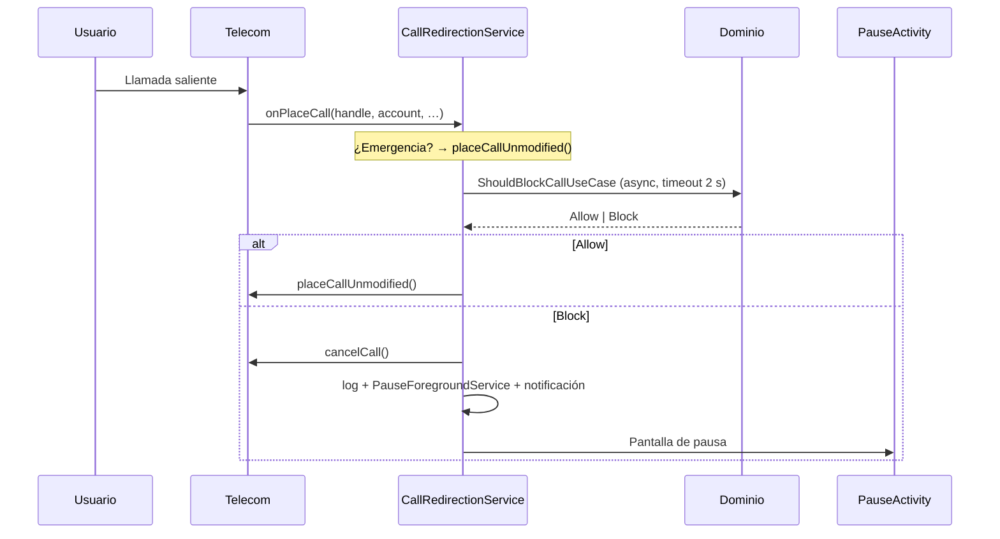

# Instant Pause

[English](README.md) · **Español** · [Français](README.fr.md)

> **Nombre anterior: CoolDown.** Desde la versión **1.4.0**, el identificador de la
> aplicación es `com.instantpause.app`: `com.cooldown.app` y `com.cooldown` ya estaban
> ocupados en Google Play. Por lo tanto, Android considera la 1.4.0 como una
> **aplicación diferente** — los datos de la versión anterior no se conservan. Solo los
> nombres de clases internas (`CoolDown*`) mantienen la denominación antigua.

> **Espera a mañana antes de llamar.**

Instant Pause es una aplicación Android de código abierto que te ayuda a **resistir las
llamadas impulsivas**. Durante las franjas horarias que definas, cada llamada saliente se
intercepta y se sustituye por una **pantalla de pausa sensorial**: respirar, calmarse y
luego decidir.

Sin bloqueo de emergencia, sin vigilancia, sin servidor: todo se queda en tu teléfono.

---

## Contenido

- [El concepto](#el-concepto)
- [Funcionalidades](#funcionalidades)
- [Bloqueo de protección](#bloqueo-de-protección)
- [Cómo funciona](#cómo-funciona)
- [Arquitectura](#arquitectura)
- [Stack técnico](#stack-técnico)
- [Instalación](#instalación)
- [Google Play](#google-play)
- [Compilación](#compilación)
- [Pruebas](#pruebas)
- [Permisos](#permisos)
- [Límites conocidos](#límites-conocidos)
- [Hoja de ruta](#hoja-de-ruta)
- [Privacidad](#privacidad)

---

## El concepto

Muchas llamadas se hacen en un momento de ira, cansancio o impulsividad — y se lamentan
diez minutos después. Instant Pause no elimina la posibilidad de llamar: **introduce un
retraso consciente** entre el impulso y la acción.

Tres mecanismos, todos bajo tu control:

| Mecanismo | Efecto |
|---|---|
| **Franjas horarias** | Recurrentes, por día de la semana (p. ej. 22:00 → 07:00) |
| **Modo Zen** | Bloqueo puntual de 2 horas, activado con un toque |
| **Lista blanca** | Contactos siempre accesibles, incluso durante una franja activa |

Los **números de emergencia** (112, 15, 17, 18, 19…) **nunca** se bloquean.

---

## Funcionalidades

### 🕐 Franjas de protección
- Franjas recurrentes en uno o varios días de la semana.
- **Cruce de medianoche** gestionado de forma nativa (22:00 → 07:00 cubre la mañana
  siguiente, teniendo en cuenta el día de inicio).
- Límite inicial incluido, límite final excluido.
- Activación / desactivación instantánea con un interruptor.

### 🧘 Modo Zen
Un botón «¿Necesitas una pausa ahora?» activa una protección inmediata de **2 horas**, sin
crear una franja permanente.

### 📇 Círculo de confianza (lista blanca)
Una pestaña **Contactos** permite designar hasta **3 personas** cuyas llamadas siempre
pasan, incluso en plena franja de protección.
- El contacto se elige en la agenda de Android (botón **+**): el selector del sistema solo
  presta la ficha elegida, por lo que la app **nunca** solicita el permiso
  `READ_CONTACTS` ni lee el resto de la agenda.
- El contador `1 / 3` permanece visible; al llegar a 3, el botón de añadir desaparece.
- Al igual que desactivar una franja, **añadir o quitar** un contacto exige el código: es
  una acción que modifica la protección.
- La comparación se hace en **E.164**, así que `06 12 34 56 78`, `+33 6 12 34 56 78` y
  `0033612345678` se reconocen como el mismo número (mediante `libphonenumber`).
- Una llamada autorizada está **limitada a 3 minutos de conversación**: una burbuja
  flotante muestra «Tiempo restante» y el cronómetro (`2:59 / 3:00`), la notificación
  repite la mención y una vibración avisa a los 0:30 y a los 0:00.
  La cuenta atrás empieza en la **conexión** (el tono de llamada no consume tiempo de
  conversación) y, a las 0:00, la llamada **se cuelga automáticamente** gracias al permiso
  `ANSWER_PHONE_CALLS`.
  Este permiso es **obligatorio**: se solicita durante la instalación y la app no se abre
  sin él, de lo contrario el límite de 3 minutos solo sería un recordatorio visual.

### 🌬️ Pantalla de pausa
Cuando se bloquea una llamada, aparece una pantalla completa (incluso con el teléfono
bloqueado):
- círculo de respiración animado y **vibración suave sincronizada**;
- un mensaje amable en lugar de un simple «Llamada bloqueada»;
- un botón **Cerrar** deliberadamente inactivo durante unos segundos.

### 🔔 Una sola alerta
Cuando se bloquea una llamada, aparece **una** notificación «Llamada bloqueada» y vibra una
vez. Nunca se repite: la llamada ya está rechazada, insistir cada 30 segundos no aporta
nada y empuja a desactivar las notificaciones de la app. Desaparece con un toque (pantalla
de pausa) o con un deslizamiento.

### 📜 Historial
Cada decisión se registra localmente: número, fecha, estado
(`Bloqueada`, `Autorizada (lista blanca)`, `Cerrada por el usuario`).
Las entradas de más de **90 días** se purgan automáticamente.

### 🔒 Bloqueo de protección
Un **código alfanumérico** (mínimo 6 caracteres, al menos una letra y un dígito) es
**obligatorio desde la primera apertura** de la app: imposible ignorarlo, imposible
eliminarlo después. Impide desactivar la protección en un arrebato. Solo se solicita para
las acciones que **debilizan** la protección — nunca para bloquear una llamada o añadir una
franja. Consulta [Bloqueo de protección](#bloqueo-de-protección).

### 🛡️ Robustez
- **Watchdog** en servicio en primer plano: la app sobrevive a los gestores de batería
  agresivos (fabricantes chinos en particular).
- **Reinicio**: la protección se rearma tras un reinicio o una actualización.
- **Fail-open**: cualquier error, cualquier tiempo de espera agotado o la muerte del
  servicio deja pasar la llamada. El peor escenario es «la llamada pasa», nunca «la
  llamada se pierde».

---

## Bloqueo de protección

El enemigo no es un atacante: eres **tú**, en un mal día. Por eso el bloqueo está diseñado
para resistir la impulsividad, no para proteger un secreto.

### Obligatorio, no opcional

En el primer arranque, la app muestra una pantalla única: **elegir el código**. Mientras no
exista, no se puede acceder a ninguna franja, ni al rol Telecom, ni a ningún ajuste. La
versión 1.1.0 dejaba el código como opcional: se podía activar la protección y luego
desactivarla sin haber definido nada. Está corregido: el código se crea en frío, antes que
todo lo demás, y ya no se puede eliminar desde la app (solo un **cambio**, con el código
anterior, es posible).

El código se crea **bloqueado**: incluso en los segundos posteriores a su creación,
desactivar una franja vuelve a pedir el código. Sin periodo de gracia.

### Qué exige el código

| Acción | Código necesario |
|---|---|
| Desactivar una franja activa | ✅ |
| Eliminar una franja (incluido un Zen en curso) | ✅ |
| Cambiar el código | ✅ |
| Quitar la protección anti-desinstalación | ✅ |
| Bloquear una llamada, añadir una franja, activar el Zen | ❌ |
| Consultar el historial | ❌ |

### Cómo se almacena

- **PBKDF2-HMAC-SHA256**, sal aleatoria de 16 bytes, **120 000 iteraciones**, 256 bits.
- El código **nunca** se escribe en claro: solo se conservan la sal, el hash y el número de
  iteraciones en DataStore.
- Comparación en tiempo constante (`MessageDigest.isEqual`).
- El estado «desbloqueado» existe **solo en memoria**: muere con el proceso y se restablece
  tras **60 segundos** en segundo plano.

### Retardo progresivo

Tres intentos libres, luego 30 s, 1 min, 2 min, 4 min… hasta **15 minutos** entre intentos.
El contador se persiste: matar la app no lo reinicia; reiniciar el teléfono tampoco.

### Anti-desinstalación (Device Admin)

El administrador de dispositivos es **sin ninguna política** (sin bloqueo de pantalla, sin
borrado de datos). Android se niega entonces a desinstalar la app mientras este
administrador esté activo.

Se solicita **durante la instalación**, justo después de crear el código: la app no pasa a
la autorización de llamadas hasta que está activo. Android exige una confirmación del
sistema (ninguna app puede activarse sola), pero Instant Pause abre esa pantalla
automáticamente en lugar de esperar a que la encuentres en la pestaña Seguridad.

Una vez superado este paso, no vuelve a aparecer: quitar el administrador con tu código
desde la pestaña Seguridad sigue siendo posible, y no encierra al usuario en un bucle.

> **Seamos honestos**: ninguna aplicación puede impedir una desinstalación. El
> administrador añade dos pasos (Ajustes → Seguridad → Administradores de dispositivos →
> desactivar), y ya está. Es un freno que rompe el gesto reflejo, no un candado.

### Lo que el bloqueo no hace

- **No** impide abrir la app (decisión asumida: la protección debe seguir siendo
  consultable).
- No resiste a `adb`, al modo seguro ni a un borrado de los datos de la app.
- No protege contra la desactivación del administrador desde los Ajustes del sistema.
- **Código olvidado = ninguna recuperación posible**: hay que borrar los datos de la app
  (lo que también elimina las franjas) o desinstalarla tras quitar el administrador.

---

## Cómo funciona

Instant Pause utiliza la API **Android Telecom** `CallRedirectionService`, disponible desde
Android 10 mediante el rol del sistema `ROLE_CALL_REDIRECTION`.



Puntos de diseño importantes:

1. **Ninguna E/S en el hilo de callback de Telecom** — la decisión se calcula en un
   `CoroutineScope(SupervisorJob + Dispatchers.IO)`, con un tiempo de espera de 2 s.
2. **Una sola respuesta por llamada** — una guarda `AtomicBoolean` por llamada impide la
   doble respuesta (que provocaría una `IllegalStateException` en el lado de Telecom).
3. **Fail-open explícito** — cada fallo se registra, nunca en silencio.
4. **Notificación síncrona en `decline()`** — Telecom destruye el servicio justo después de
   `cancelCall()`; un `launch()` se cancelaría antes de ejecutarse.

---

## Arquitectura

Organización en cuatro capas, sin dependencia del dominio hacia la UI o Android.

```
app/src/main/java/com/instantpause/app/
├── CoolDownApplication.kt          # @HiltAndroidApp
├── data/
│   ├── datastore/ProtectionPrefs.kt    # DataStore: Zen, rol, banner, hash del código
│   ├── local/                          # Room: entidades, DAO, base, converters
│   └── repository/RepositoryImpls.kt   # Implementaciones + purga de 90 días
├── di/                                 # Módulos Hilt (DataStore, seguridad, hasher, reloj)
├── domain/
│   ├── model/Models.kt                 # Schedule, WhitelistEntry, BlockedLog
│   ├── phone/                          # PhoneNumberAnalyzer (interfaz) + implementación
│   ├── repository/Repositories.kt      # Contratos
│   ├── security/                       # PassphrasePolicy, PBKDF2, retardos, AppLockManager
│   └── usecase/ShouldBlockCallUseCase.kt  # Núcleo: Allow / Block
├── system/
│   ├── CoolDownCallRedirectionService.kt  # Intercepción Telecom
│   ├── PauseForegroundService.kt          # Apertura de la UI desde segundo plano
│   ├── CoolDownWatchdogService.kt         # Mantener el proceso vivo
│   ├── WatchdogAlarmReceiver.kt           # Rearme periódico
│   ├── CoolDownDeviceAdminReceiver.kt     # Anti-desinstalación (sin política)
│   ├── ProtectionAlertNotifier.kt         # Canales + notificaciones
│   └── BootReceiver.kt                    # Tras reinicio / actualización
└── ui/
    ├── main/      # Inicio, banner de ayuda, activación del rol
    ├── schedule/  # Franjas + historial (Compose)
    ├── security/  # Bloqueo: código, retardos, administrador
    ├── pause/     # Pantalla de pausa sensorial
    ├── logs/      # Registro detallado
    └── theme/     # Material 3
```

**Decisión de negocio** (`ShouldBlockCallUseCase`):

```
¿Emergencia?          → Allow(EMERGENCY_NUMBER)   // nunca bloqueada
¿Modo Zen activo?     → Block(EMERGENCY_MODE)
¿Franja activa?       → Block(SCHEDULE_WINDOW)
¿Lista blanca?        → Allow(WHITELISTED)
Si no                 → Allow(PROTECTION_INACTIVE)
Error / timeout       → Allow(FAIL_OPEN)
```

---

## Stack técnico

| Categoría | Elección |
|---|---|
| Lenguaje | Kotlin 2.2.10 |
| UI | Jetpack Compose + Material 3 (BOM 2026.02.01) |
| Inyección de dependencias | Hilt 2.60.1 (KSP) |
| Base local | Room 2.8.5 |
| Preferencias | DataStore Preferences 1.2.1 |
| Números | libphonenumber 9.0.41 |
| Build | AGP 9.4.1 · JDK 17 |
| SDK | `minSdk 29` (Android 10) · `targetSdk 37` |

Sin dependencia de red, sin analítica, sin cuenta.

---

## Instalación

### Descarga

La última versión firmada está disponible en **[Releases](../../releases/latest)**:

**[⬇ InstantPause-1.4.0.apk](../../releases/download/v1.4.0/InstantPause-1.4.0.apk)** — 6,4 MB · Android 10+

```bash
# Verificar la integridad del archivo descargado
sha256sum InstantPause-1.4.0.apk
# → consulta el hash publicado en la release (recalculado en cada build)
```

> 🔄 **Paquete renombrado en 1.4.0**: las versiones 1.3.x y anteriores usaban
> `com.cooldown.app`. Android no sabe pasar de un paquete a otro: para instalar la 1.4.0,
> **desinstala primero la versión anterior** (desactivando su administrador de dispositivos
> desde la pestaña Seguridad). El código, las franjas y los contactos autorizados deben
> crearse de nuevo.

> ⚠️ Si ya hay una versión de **debug** instalada, desinstálala primero: la firma es
> distinta y Android rechazará la actualización (`INSTALL_FAILED_UPDATE_INCOMPATIBLE`). El
> paquete de debug es `com.instantpause.app.debug`.

> 🛡️ Algunos antivirus preinstalados (AVG/Avast en itel, Infinix…) muestran «aplicación
> sospechosa» para cualquier APK instalado fuera de Play Store. Es una heurística sobre la
> **fuente**, no un análisis del código: no pulses «ELIMINAR». (Y si el administrador de
> Instant Pause está activo, la desinstalación fallará de todos modos.)

### Requisitos
- Android **10 (API 29)** o superior.
- El fabricante debe exponer el rol **Call Redirection**
  (disponible en casi todos los dispositivos, no garantizado en algunos forks muy
  modificados).

### Pasos
1. Instala el APK (release o build local).
2. Abre la app → **elige tu código de protección**. Es obligatorio: la pantalla no se puede
   saltar, y el código ya no podrá eliminarse después.
3. Confirma la protección **anti-desinstalación** (Device Admin): la pantalla del sistema
   se abre automáticamente en este paso, y la app no continúa hasta que esté activa.
4. Concede **Llamar y gestionar llamadas**: es lo que permite colgar la llamada a los
   3 minutos. Este paso es obligatorio — sin él, un contacto autorizado podría tenerte una
   hora al teléfono.
5. Acepta el rol **Redirección de llamadas**.
6. Permite la **visualización a pantalla completa** (Android 14+): el ajuste de Android se
   abre automáticamente. Este paso se propone **una sola vez** y no es bloqueante — sin él,
   la pantalla de pausa aparece como una simple notificación que hay que tocar.
7. Concede los permisos restantes:
   - **Notificaciones** (Android 13+) — para la alerta de bloqueo;
   - **Mostrar sobre otras apps** — para la pantalla de pausa.
8. Crea una franja horaria (o activa el modo Zen) y prueba con un número neutro.

---

## Google Play

La aplicación se publica con el identificador **`com.instantpause.app`** — inmutable una
vez creada la app en Play Console.

| Elemento | Valor |
|---|---|
| Identificador | `com.instantpause.app` (debug: `com.instantpause.app.debug`) |
| Formato a subir | **`.aab`** (`gradlew :app:bundleRelease`) |
| Target | `targetSdk 37`, `minSdk 29` |
| Firma | keystore de release; Play App Signing gestiona después la clave de distribución |
| Recogida de datos | **ninguna** (ver [Privacidad](#privacidad)) |
| Política de privacidad | **https://ajanedouby.github.io/instant-pause-privacy/** |

Antes de la primera publicación, Play Console exige:

1. una **URL de política de privacidad** pública — hecho:
   **https://ajanedouby.github.io/instant-pause-privacy/** (GitHub Pages del repositorio
   público [`instant-pause-privacy`](https://github.com/AJANEDOUBY/instant-pause-privacy),
   generada desde [`PRIVACY_POLICY.md`](PRIVACY_POLICY.md) y servida también en
   [Markdown](https://ajanedouby.github.io/instant-pause-privacy/PRIVACY_POLICY.md));
2. el formulario **Seguridad de los datos** — aquí todo es local: «ningún dato recogido»;
3. la **justificación de los permisos sensibles**, que se redacta al enviar:
   - `ANSWER_PHONE_CALLS`: colgar a los 3 minutos una llamada a un contacto autorizado;
   - administrador de dispositivos: frenar una desinstalación impulsiva (no se solicita
     ninguna política al dispositivo);
   - servicio en primer plano `specialUse`: mantener la protección y el temporizador de
     llamada;
   - `USE_FULL_SCREEN_INTENT`: mostrar la pantalla de pausa sobre el bloqueo;
4. la declaración de uso de los **servicios en primer plano** (formulario aparte).

> ⚠️ La revisión de Play es el punto de fricción, no el código: el administrador de
> dispositivos y `ANSWER_PHONE_CALLS` son los dos permisos más examinados. El repositorio
> de GitHub sigue siendo el canal de distribución de los APK firmados, independientemente
> de la Store.

---

## Compilación

```bash
# Clonar
git clone https://github.com/AJANEDOUBY/CoolDown.git
cd CoolDown

# APK de debug
./gradlew :app:assembleDebug
# → app/build/outputs/apk/debug/app-debug.apk

# Pruebas unitarias
./gradlew :app:testDebugUnitTest
```

En Windows: `gradlew.bat`.

El archivo `local.properties` (ruta del SDK) no está versionado — Android Studio lo genera
automáticamente, o indica `sdk.dir=/ruta/a/Android/Sdk`.

### Publicar una release

El script `release.ps1` encadena todo: pruebas, build release (R8), firma, verificación,
etiqueta git y publicación en GitHub con el APK como asset.

```powershell
# Simulación completa, sin etiqueta ni publicación
.\release.ps1 -DryRun

# Con notas de release personalizadas
.\release.ps1 -Notes .\notes-1.4.0.md
```

Si las credenciales de firma están configuradas (ver abajo), Gradle produce directamente un
APK firmado: el script lo verifica en lugar de volver a firmarlo. Si no, produce un APK sin
firmar, que el script alinea y firma él mismo con el keystore.

Para una subida a Google Play, genera además el bundle:

```bash
./gradlew :app:bundleRelease
# → app/build/outputs/bundle/release/app-release.aab
```

### Firma: ningún secreto en el repositorio

`app/build.gradle.kts` no contiene **ninguna** contraseña: está versionado. Las
credenciales de firma se leen de `local.properties` (ignorado por git) o, en su defecto, de
variables de entorno — práctico para una CI.

```properties
# local.properties — no hacer commit nunca (ya está en .gitignore)
signing.storeFile=keystore/cooldown-release.jks
signing.storePassword=…
signing.keyAlias=cooldown
signing.keyPassword=…
```

Variables equivalentes: `SIGNING_STORE_FILE`, `SIGNING_STORE_PASSWORD`, `SIGNING_KEY_ALIAS`,
`SIGNING_KEY_PASSWORD`.

Sin estos valores (o sin keystore), el build **no se rompe**: `assembleRelease` produce un
APK sin firmar, y `release.ps1` lo firma con `keystore/cooldown-release.jks`.

> ✅ La contraseña figuró en claro en `app/build.gradle.kts` hasta el commit `2fe34c4`.
> Se **cambió** el 7 de noviembre de 2026 y el historial público se **reescribió** con
> `git filter-repo` el 8 de noviembre de 2026. El valor antiguo está muerto: ya no abre el
> keystore, y Play App Signing no se vio afectado. Ver `docs/KEYSTORE.md`.

Requisitos:

- un **keystore** en `keystore/cooldown-release.jks` (ver `.gitignore`: este archivo no debe
  commitearse **nunca**);
- un **token de GitHub** en `$env:GITHUB_TOKEN`, o credenciales registradas en el gestor de
  credenciales de git (`git credential approve`).

La etiqueta creada es `v<versionName>`; hay que incrementar `versionName`/`versionCode` en
`app/build.gradle.kts` antes de cada publicación.

---

## Pruebas

81 pruebas unitarias cubren la lógica de negocio, sin dependencia de Android en tiempo de
ejecución:

| Suite | Cobertura |
|---|---|
| `ScheduleTest` (11) | franjas, límites incluidos/excluidos, días, cruce de medianoche |
| `ShouldBlockCallUseCaseTest` (8) | emergencia, modo Zen, franja, lista blanca, caducidad, región por defecto |
| `BlockStatusConvertersTest` (2) | mapeo Room ↔ `BlockStatus`, valor desconocido |
| `PassphrasePolicyTest` (7) | longitud, letra + dígito, normalización, acentos |
| `PassphraseHasherTest` (7) | determinismo, sal, código correcto/incorrecto, hash corrupto |
| `LockoutPolicyTest` (4) | intentos libres, duplicación, tope de 15 min, contador |
| `AppLockManagerTest` (20) | ciclo de vida, código creado bloqueado, reinicio, retardo persistido, rebloqueo 60 s, cambio/eliminación, fallo de almacenamiento |
| `CallTimerTextTest` (4) | formato `2:59 / 3:00`, segundos siempre con dos dígitos, dígitos latinos sea cual sea la locale |
| `OnboardingStageTest` (17) | orden de los pasos: código → anti-desinstalación → colgar → rol → pantalla completa → app |

Es decir, **81 pruebas** en total.

```bash
./gradlew :app:testDebugUnitTest
# → app/build/reports/tests/testDebugUnitTest/index.html
```

El use case depende de la interfaz `PhoneNumberAnalyzer` (y no de la implementación
Android), lo que permite ejecutarlo con fakes en memoria.

> Los escenarios que implican Telecom (intercepción real, servicios en primer plano,
> notificaciones) deben validarse en un **dispositivo físico**: el emulador no siempre
> expone el rol `ROLE_CALL_REDIRECTION`.

---

## Permisos

| Permiso | Motivo |
|---|---|
| `BIND_CALL_REDIRECTION_SERVICE` | Acceso al flujo Telecom (concedido mediante el rol del sistema, no por el usuario) |
| `POST_NOTIFICATIONS` | Alerta única de bloqueo |
| `VIBRATE` | Respuesta háptica de la pantalla de pausa |
| `SYSTEM_ALERT_WINDOW` | Mostrar la pantalla de pausa sobre el marcador |
| `USE_FULL_SCREEN_INTENT` | Visualización en pantalla bloqueada — se propone una vez al instalar en Android 14+ (no bloqueante) |
| `RECEIVE_BOOT_COMPLETED` | Rearme tras el reinicio |
| `SCHEDULE_EXACT_ALARM` | Alarma de seguridad cada 15 min (recurso inexacto si se deniega) |
| `REQUEST_IGNORE_BATTERY_OPTIMIZATIONS` | Proponer la exención de energía desde el banner |
| `FOREGROUND_SERVICE` / `FOREGROUND_SERVICE_SPECIAL_USE` | Watchdog, apertura de UI |
| `ANSWER_PHONE_CALLS` | Colgar a las 3:00 la llamada a un contacto autorizado — permiso obligatorio al instalar |
| `BIND_DEVICE_ADMIN` (en el receiver) | Fricción anti-desinstalación — ninguna política solicitada, paso obligatorio al instalar |

---

## Límites conocidos

- **Llamadas VoIP no cubiertas** (WhatsApp, Signal, Messenger, Telegram) — *próximo
  proyecto, fuera del alcance de la 1.4.x*. Estas apps no llaman a través de Telecom: abren
  su propio flujo de audio, y `CallScreeningService` nunca se consulta. Ninguna API de
  Android permite a una app de terceros ver ni rechazar una llamada VoIP. En concreto,
  durante una franja protegida:
  - una llamada de WhatsApp o Signal sale **normalmente**;
  - Instant Pause no la ve, no la muestra en el historial y no muestra la pantalla de
    pausa;
  - solo se cubren las **llamadas telefónicas clásicas**.

  La única pista realista es un **servicio de accesibilidad** que detecte la apertura de la
  ventana de llamada y superponga la pantalla de pausa. Tres razones para no haberlo hecho:
  1. el bloqueo sería **parcial y tardío**: se puede interponer una pantalla antes de la
     conexión, pero no cancelar una llamada ya establecida;
  2. el permiso «Accesibilidad» da lectura de **todo** lo que se muestra, mensajes
     incluidos; para una app que vende tranquilidad, este compromiso debe elegirlo
     explícitamente el usuario, no heredarse de una actualización;
  3. la detección depende del texto y de la estructura de la UI de cada app: se rompe con
     cada rediseño de WhatsApp o Signal.

  Mientras tanto, el alcance es asumido y se muestra como tal: **las llamadas de
  aplicaciones no se bloquean**. Ver la [hoja de ruta](#hoja-de-ruta).
- **Números de emergencia**: deliberadamente fuera de alcance, y **no testeables** en
  desarrollo.
- **Colgado a las 3:00 garantizado por un permiso obligatorio**: `TelecomManager.endCall()`,
  la única API que permite a una app de terceros cortar una línea, exige
  `ANSWER_PHONE_CALLS`. Este permiso forma parte de la instalación: sin él, la app no se
  abre (de lo contrario el límite solo sería un recordatorio). Una vez concedido, la
  llamada se corta en seco al final del temporizador. La burbuja desaparece sola al colgar;
  si la llamada nunca se estableció (ocupado, sin respuesta), puede permanecer hasta el
  vencimiento de los 3 minutos.
- **Rol revocable**: si el sistema retira `ROLE_CALL_REDIRECTION` (otra app de filtrado, una
  actualización), la protección se detiene; la app lo detecta y muestra un banner.
- **Bloqueo evitable**: el código protege los ajustes de la app, no el sistema. `adb`, un
  borrado de datos, el modo seguro o la desactivación del administrador desde los Ajustes
  siguen siendo posibles. Ver [Bloqueo de protección](#bloqueo-de-protección).
- **Respuesta interactiva**: la autorización con un toque (`allowInteractiveResponse` de
  Telecom) aún no está implementada — el bloqueo es binario.
- **Fork de fabricante**: las capas muy agresivas (gestión de batería, autostart) pueden
  matar el watchdog y **retrasar `BOOT_COMPLETED`** hasta no entregarlo nunca. En estos
  dispositivos (itel/Transsion, Xiaomi, Infinix…), permite Instant Pause en **Inicio
  automático** y **sin restricciones de energía**. La app muestra un banner ámbar mientras
  falte la exención de energía. La intercepción de llamadas, en cambio, **sigue
  funcionando**: Telecom reinicia el proceso en frío en cada llamada, y el watchdog se
  rearma en esa ocasión.

---

## Hoja de ruta

- [ ] Respuesta interactiva mediante `redirectCall()` (autorizar la llamada desde la
      pantalla de pausa)
- [ ] Bloqueo de llamadas VoIP: overlay mediante servicio de accesibilidad al abrir
      WhatsApp/Signal/Telegram durante una franja protegida (código o respiración para
      entrar). **Aplazado** — ver [Límites conocidos](#límites-conocidos) para los
      compromisos que hay que decidir antes de escribir código.
- [ ] Franjas por defecto propuestas en el primer arranque
- [ ] Importación de contactos para la lista blanca
- [ ] Estadísticas (llamadas evitadas por semana)
- [ ] Widget / mosaico de ajustes rápidos para el modo Zen
- [ ] Pruebas instrumentadas (PauseActivity, servicios en primer plano)

---

## Privacidad

La política completa está en [`PRIVACY_POLICY.md`](PRIVACY_POLICY.md) y publicada en línea en
**https://ajanedouby.github.io/instant-pause-privacy/**.

- **Ninguna conexión de red.** La app no contiene ni cliente HTTP ni SDK publicitario.
- **Ninguna cuenta, ningún identificador.**
- Franjas, lista blanca e historial permanecen en el almacenamiento privado de la
  aplicación (Room + DataStore).
- `android:allowBackup="false"`: sin copia de seguridad automática en la nube.
- El historial de llamadas de Instant Pause es **distinto** del registro de llamadas del
  sistema.

---

## Aviso

Instant Pause es una herramienta de autodisciplina, no un dispositivo médico ni un control
parental. No sustituye a un acompañamiento profesional si tus dificultades están
relacionadas con tu salud.

Prueba siempre la aplicación con un **número neutro** antes de contar con ella a diario.
