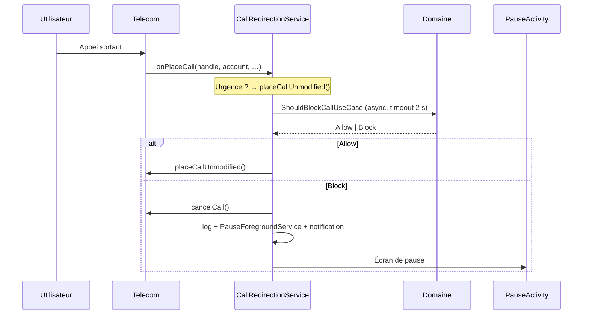

# Instant Pause

> **Ancien nom : CoolDown.** Depuis la version **1.4.0**, l'identifiant de l'application est
> `com.instantpause.app` : `com.cooldown.app` et `com.cooldown` étaient déjà réservés sur
> Google Play. Android considère donc la 1.4.0 comme une **application différente** — les
> données de l'ancienne version ne suivent pas. Seuls les noms de classes internes
> (`CoolDown*`) gardent l'ancienne appellation.

> **Attendez demain avant d'appeler.**

Instant Pause est une application Android open source qui vous aide à **résister aux appels impulsifs**.
Pendant les plages horaires que vous définissez, chaque appel sortant est intercepté et remplacé par
un **écran de pause sensoriel** : respirer, se calmer, puis décider.

Pas de blocage d'urgence, pas de surveillance, pas de serveur : tout reste sur votre téléphone.

---

## Sommaire

- [Le concept](#le-concept)
- [Fonctionnalités](#fonctionnalités)
- [Verrou de protection](#verrou-de-protection)
- [Comment ça marche](#comment-ça-marche)
- [Architecture](#architecture)
- [Stack technique](#stack-technique)
- [Installation](#installation)
- [Google Play](#google-play)
- [Compilation](#compilation)
- [Tests](#tests)
- [Permissions](#permissions)
- [Limites connues](#limites-connues)
- [Feuille de route](#feuille-de-route)
- [Confidentialité](#confidentialité)

---

## Le concept

Beaucoup d'appels sont passés dans un moment de colère, de fatigue ou d'impulsivité — et regrettés
dix minutes plus tard. Instant Pause ne supprime pas la possibilité d'appeler : il **insère un délai
conscient** entre l'envie et l'action.

Trois mécanismes, tous contrôlés par vous :

| Mécanisme | Effet |
|---|---|
| **Plages horaires** | Récurrentes, par jour de la semaine (ex. 22:00 → 07:00) |
| **Mode Zen** | Blocage ponctuel de 2 heures, déclenché en un tap |
| **Whitelist** | Contacts toujours joignables, même pendant une plage active |

Les **numéros d'urgence** (112, 15, 17, 18, 19…) ne sont **jamais** bloqués.

---

## Fonctionnalités

### 🕐 Plages de protection
- Plages récurrentes sur un ou plusieurs jours de la semaine.
- **Franchissement de minuit** géré nativement (22:00 → 07:00 couvre bien le lendemain matin,
  en tenant compte du jour de départ).
- Borne de début incluse, borne de fin exclue.
- Activation / désactivation instantanée par un interrupteur.

### 🧘 Mode Zen
Un bouton « Besoin d'une pause maintenant ? » active une protection immédiate de **2 heures**,
sans créer de plage permanente.

### 📇 Cercle de confiance (whitelist)
Un onglet **Contacts** permet de désigner jusqu'à **3 personnes** dont les appels passent
toujours, même en pleine plage de protection.
- Le contact est choisi dans le répertoire Android (bouton **+**) : le sélecteur système
  ne prête que la fiche choisie, l'app ne demande donc **jamais** la permission
  `READ_CONTACTS` et ne lit pas le reste du carnet.
- Le compteur `1 / 3` reste visible ; à 3, le bouton d'ajout disparaît.
- Comme couper une plage, **ajouter ou retirer** un contact exige le code : c'est une
  action qui modifie la protection.
- La comparaison se fait en **E.164**, donc `06 12 34 56 78`, `+33 6 12 34 56 78` et
  `0033612345678` sont reconnus comme le même numéro (via `libphonenumber`).
- Un appel autorisé est **limité à 3 minutes de conversation** : une pastille flottante
  affiche « Temps restant » et le chronomètre (`2:59 / 3:00`), la notification reprend la
  mention, et une vibration signale 0:30 puis 0:00.
  Le décompte part de la **connexion** (la sonnerie ne mange pas le temps de parole) et, à
  0:00, l'appel est **raccroché automatiquement** grâce à la permission `ANSWER_PHONE_CALLS`.
  Cette permission est **obligatoire** : elle est demandée pendant l'installation et l'app
  ne s'ouvre pas sans elle, sinon la limite de 3 minutes ne serait qu'un rappel visuel.

### 🌬️ Écran de pause
Quand un appel est bloqué, un écran plein écran s'affiche (même verrouillé) :
- cercle de respiration animé et **vibration douce synchronisée** ;
- message bienveillant plutôt qu'un simple « Appel bloqué » ;
- bouton **Fermer** volontairement inactif quelques secondes.

### 🔔 Une seule alerte
Quand un appel est bloqué, **une** notification « Appel bloqué » s'affiche et vibre une fois.
Elle n'est jamais répétée : l'appel est déjà refusé, insister toutes les 30 secondes n'apporte
rien et pousse à couper les notifications de l'app. Elle disparaît d'un tap (écran de pause) ou
d'un balayage.

### 📜 Historique
Chaque décision est journalisée localement : numéro, date, statut
(`Bloqué`, `Autorisé (whitelist)`, `Fermé par l'utilisateur`).
Les entrées de plus de **90 jours** sont purgées automatiquement.

### 🔒 Verrou de protection
Un **code alphanumérique** (6 caractères minimum, au moins une lettre et un chiffre) est
**obligatoire dès la première ouverture** de l'app : impossible de l'ignorer, impossible de le
supprimer ensuite. Il empêche de couper la protection sur un coup de tête. Il n'est demandé
que pour les actions qui **affaiblissent** la protection — jamais pour bloquer un appel ou
ajouter une plage.
Voir la section [Verrou de protection](#verrou-de-protection).

### 🛡️ Robustesse
- **Watchdog** en foreground service : l'app survit aux gestionnaires de batterie agressifs
  (constructeurs chinois notamment).
- **Redémarrage** : la protection est ré-armée après un reboot ou une mise à jour.
- **Fail-open** : toute erreur, tout timeout ou une mort du service laisse passer l'appel.
  Le pire scénario est « l'appel passe », jamais « l'appel est perdu ».

---

## Verrou de protection

L'ennemi n'est pas un attaquant : c'est **vous**, dans un mauvais jour. Le verrou est donc
conçu pour résister à l'impulsivité, pas pour protéger un secret.

### Obligatoire, pas optionnel

Au premier lancement, l'app affiche un écran unique : **choisir le code**. Tant qu'il n'existe
pas, aucune plage, aucun rôle Telecom, aucun réglage n'est accessible. La version 1.1.0 laissait
le code facultatif : on pouvait activer la protection puis la couper sans jamais rien définir.
C'est corrigé : le code est créé à froid, avant tout le reste, et il ne peut plus être supprimé
depuis l'app (seul un **changement**, avec l'ancien code, est possible).

Le code est créé **verrouillé** : même dans les secondes qui suivent sa création, couper une
plage redemande le code. Pas de fenêtre de gratuité.

### Ce qui demande le code

| Action | Code requis |
|---|---|
| Couper une plage active | ✅ |
| Supprimer une plage (y compris Zen en cours) | ✅ |
| Changer le code | ✅ |
| Retirer la protection anti-désinstallation | ✅ |
| Bloquer un appel, ajouter une plage, activer le Zen | ❌ |
| Consulter l'historique | ❌ |

### Comment il est stocké

- **PBKDF2-HMAC-SHA256**, sel aléatoire de 16 octets, **120 000 itérations**, 256 bits.
- Le code n'est **jamais** écrit en clair : seuls le sel, l'empreinte et le nombre d'itérations
  sont conservés dans DataStore.
- Comparaison à temps constant (`MessageDigest.isEqual`).
- L'état « déverrouillé » n'existe qu'**en mémoire** : il meurt avec le processus et retombe
  après **60 secondes** passées en arrière-plan.

### Temporisation progressive

Trois essais libres, puis 30 s, 1 min, 2 min, 4 min… jusqu'à **15 minutes** entre deux essais.
Le compteur est persisté : tuer l'app ne le remet pas à zéro ; redémarrer le téléphone non plus.

### Anti-désinstallation (Device Admin)

L'administrateur d'appareil est **sans aucune politique** (pas de verrouillage d'écran, pas
d'effacement de données). Android refuse alors de désinstaller l'app tant que cet
administrateur est actif.

Il est demandé **pendant l'installation**, juste après la création du code : l'app ne passe
pas à l'autorisation des appels tant qu'il n'est pas actif. Android exige une confirmation
système (aucune app ne peut s'activer seule), mais Instant Pause ouvre cet écran
automatiquement plutôt que d'attendre que vous le trouviez dans l'onglet Sécurité.

Une fois l'étape franchie, elle ne réapparaît plus : retirer l'administrateur avec son code
depuis l'onglet Sécurité reste possible, et n'enferme pas l'utilisateur dans une boucle.

> **Soyons honnêtes** : aucune application ne peut empêcher une désinstallation. L'administrateur
> ajoute deux étapes (Paramètres → Sécurité → Administrateurs → désactiver), et c'est tout.
> C'est un ralentisseur qui casse le geste réflexe, pas un cadenas.

### Ce que le verrou ne fait pas

- Il ne bloque **pas** le lancement de l'app (choix assumé : la protection doit rester consultable).
- Il ne résiste pas à `adb`, au mode sans échec, ni à un effacement des données de l'app.
- Il ne protège pas contre une désactivation de l'administrateur depuis les Paramètres système.
- **Code oublié = aucune récupération possible** : il faut effacer les données de l'app
  (ce qui supprime aussi les plages) ou la désinstaller après avoir retiré l'administrateur.

---

Instant Pause exploite l'API **Android Telecom** `CallRedirectionService`, disponible depuis Android 10
via le rôle système `ROLE_CALL_REDIRECTION`.



Points de conception importants :

1. **Aucune I/O sur le thread du callback Telecom** — la décision est calculée dans un
   `CoroutineScope(SupervisorJob + Dispatchers.IO)`, avec un timeout de 2 s.
2. **Une seule réponse par appel** — une garde `AtomicBoolean` par appel empêche la double réponse
   (qui provoquerait un `IllegalStateException` côté Telecom).
3. **Fail-open explicite** — chaque échec est journalisé, jamais silencieux.
4. **Notification synchrone dans `decline()`** — Telecom détruit le service juste après
   `cancelCall()` ; un `launch()` serait annulé avant exécution.

---

## Architecture

Organisation en quatre couches, sans dépendance du domaine vers l'UI ou Android.

```
app/src/main/java/com/instantpause/app/
├── CoolDownApplication.kt          # @HiltAndroidApp
├── data/
│   ├── datastore/ProtectionPrefs.kt    # DataStore : Zen, rôle, bandeau, empreinte du code
│   ├── local/                          # Room : entités, DAO, base, converters
│   └── repository/RepositoryImpls.kt   # Implémentations + purge 90 jours
├── di/                                 # Modules Hilt (DataStore, sécurité, hasher, horloge)
├── domain/
│   ├── model/Models.kt                 # Schedule, WhitelistEntry, BlockedLog
│   ├── phone/                          # PhoneNumberAnalyzer (interface) + implémentation
│   ├── repository/Repositories.kt      # Contrats
│   ├── security/                       # PassphrasePolicy, PBKDF2, temporisations, AppLockManager
│   └── usecase/ShouldBlockCallUseCase.kt  # Cœur métier : Allow / Block
├── system/
│   ├── CoolDownCallRedirectionService.kt  # Interception Telecom
│   ├── PauseForegroundService.kt          # Ouverture de l'UI depuis l'arrière-plan
│   ├── CoolDownWatchdogService.kt         # Maintien en vie
│   ├── WatchdogAlarmReceiver.kt           # Ré-armement périodique
│   ├── CoolDownDeviceAdminReceiver.kt     # Anti-désinstallation (aucune politique)
│   ├── ProtectionAlertNotifier.kt         # Canaux + notifications
│   └── BootReceiver.kt                    # Après reboot / mise à jour
└── ui/
    ├── main/      # Accueil, bandeau d'aide, activation du rôle
    ├── schedule/  # Plages + historique (Compose)
    ├── security/  # Verrou : code, temporisations, administrateur
    ├── pause/     # Écran de pause sensoriel
    ├── logs/      # Journal détaillé
    └── theme/     # Material 3
```

**Décision métier** (`ShouldBlockCallUseCase`) :

```
Urgence ?            → Allow(EMERGENCY_NUMBER)   // jamais bloqué
Mode Zen actif ?     → Block(EMERGENCY_MODE)
Plage active ?       → Block(SCHEDULE_WINDOW)
Whitelist ?          → Allow(WHITELISTED)
Sinon                → Allow(PROTECTION_INACTIVE)
Erreur / timeout     → Allow(FAIL_OPEN)
```

---

## Stack technique

| Catégorie | Choix |
|---|---|
| Langage | Kotlin 2.2.10 |
| UI | Jetpack Compose + Material 3 (BOM 2026.02.01) |
| Injection de dépendances | Hilt 2.60.1 (KSP) |
| Base locale | Room 2.8.5 |
| Préférences | DataStore Preferences 1.2.1 |
| Numéros | libphonenumber 9.0.41 |
| Build | AGP 9.4.1 · JDK 17 |
| SDK | `minSdk 29` (Android 10) · `targetSdk 37` |

Aucune dépendance réseau, aucun analytics, aucun compte.

---

## Installation

### Téléchargement

La dernière version signée est disponible dans les **[Releases](../../releases/latest)** :

**[⬇ InstantPause-1.4.0.apk](../../releases/download/v1.4.0/InstantPause-1.4.0.apk)** — 6,4 Mo · Android 10+

```bash
# Vérifier l'intégrité du fichier téléchargé
sha256sum InstantPause-1.4.0.apk
# → voir le hash publié dans la release (recalculé à chaque build)
```

> 🔄 **Paquet renommé en 1.4.0** : les versions 1.3.x et antérieures utilisaient
> `com.cooldown.app`. Android ne sait pas passer d'un paquet à l'autre : pour installer la
> 1.4.0, **désinstallez d'abord l'ancienne version** (en désactivant son administrateur
> d'appareil depuis l'onglet Sécurité). Code, plages et contacts autorisés sont à recréer.

> ⚠️ Si une version de **debug** est déjà installée, désinstallez-la d'abord : la signature
> diffère, Android refusera la mise à jour (`INSTALL_FAILED_UPDATE_INCOMPATIBLE`). Le paquet
> de debug est `com.instantpause.app.debug`.

> 🛡️ Certains antivirus préinstallés (AVG/Avast sur itel, Infinix…) affichent « application
> suspecte » pour tout APK installé hors Play Store. C'est une heuristique sur la **source**,
> pas une analyse du code : ne validez pas « SUPPRIMER ». (Et si l'administrateur Instant Pause est
> actif, la désinstallation échouera de toute façon.)

### Prérequis
- Android **10 (API 29)** ou supérieur.
- Le constructeur doit exposer le rôle **Call Redirection**
  (disponible sur la quasi-totalité des appareils, non garanti sur certains forks très modifiés).

### Étapes
1. Installez l'APK (release ou build locale).
2. Ouvrez l'app → **choisissez votre code de protection**. Il est obligatoire : l'écran ne se
   contourne pas, et le code ne pourra plus être supprimé ensuite.
3. Confirmez la protection **anti-désinstallation** (Device Admin) : l'écran système s'ouvre
   automatiquement à cette étape, et l'app ne continue pas tant qu'elle n'est pas active.
4. Accordez **Passer et gérer des appels téléphoniques** : c'est ce qui permet de couper
   l'appel à 3 minutes. Cette étape est obligatoire — sans elle, un contact autorisé
   pourrait vous garder une heure au téléphone.
5. Acceptez le rôle **Redirection d'appels**.
6. Autorisez l'**affichage plein écran** (Android 14+) : le réglage Android s'ouvre
   automatiquement. Cette étape est proposée **une seule fois** et n'est pas bloquante —
   sans elle, l'écran de pause s'affiche comme une simple notification à toucher.
7. Accordez les permissions restantes :
   - **Notifications** (Android 13+) — pour l'alerte de blocage ;
   - **Affichage par-dessus les autres apps** — pour l'écran de pause.
8. Créez une plage horaire (ou activez le mode Zen) et testez avec un numéro neutre.

---

## Google Play

L'application est publiée sous l'identifiant **`com.instantpause.app`** — immuable une fois
l'app créée dans la Play Console.

| Élément | Valeur |
|---|---|
| Identifiant | `com.instantpause.app` (debug : `com.instantpause.app.debug`) |
| Format à déposer | **`.aab`** (`gradlew :app:bundleRelease`) |
| Cible | `targetSdk 37`, `minSdk 29` |
| Signature | keystore de release ; Play App Signing gère ensuite la clé de distribution |
| Collecte de données | **aucune** (voir [Confidentialité](#confidentialité)) |

Avant la première publication, la Play Console réclame :

1. une **URL de politique de confidentialité** publique (le fichier
   [`PRIVACY_POLICY.md`](PRIVACY_POLICY.md) doit être accessible en ligne, pas seulement dans
   le dépôt) ;
2. le formulaire **Sécurité des données** — ici, tout est local : « aucune donnée collectée » ;
3. la **justification des permissions sensibles**, à rédiger au moment de l'envoi :
   - `ANSWER_PHONE_CALLS` : couper à 3 minutes un appel vers un contact autorisé ;
   - administrateur d'appareil : freiner une désinstallation impulsive (aucune politique
     n'est demandée à l'appareil) ;
   - service de premier plan `specialUse` : maintien de la protection et minuteur d'appel ;
   - `USE_FULL_SCREEN_INTENT` : afficher l'écran de pause par-dessus le verrouillage ;
4. la déclaration d'usage des **services de premier plan** (formulaire séparé).

> ⚠️ La revue Play est le point de friction, pas le code : l'administrateur d'appareil et
> `ANSWER_PHONE_CALLS` sont les deux permissions les plus scrutées. Le dépôt GitHub reste le
> canal de distribution des APK signés, indépendamment du Store.

---

## Compilation

```bash
# Cloner
git clone https://github.com/AJANEDOUBY/CoolDown.git
cd CoolDown

# APK de debug
./gradlew :app:assembleDebug
# → app/build/outputs/apk/debug/app-debug.apk

# Tests unitaires
./gradlew :app:testDebugUnitTest
```

Sous Windows : `gradlew.bat`.

Le fichier `local.properties` (chemin du SDK) n'est pas versionné — Android Studio le génère
automatiquement, ou renseignez `sdk.dir=/chemin/vers/Android/Sdk`.

### Publier une release

Le script `release.ps1` enchaîne tout : tests, build release (R8), signature, vérification,
tag git et publication GitHub avec l'APK en asset.

```powershell
# Simulation complète, sans tag ni publication
.\release.ps1 -DryRun

# Avec des notes de release personnalisées
.\release.ps1 -Notes .\notes-1.4.0.md
```

Si `signingConfig` est déclaré dans `app/build.gradle.kts`, Gradle produit directement un APK
signé : le script le vérifie au lieu de le re-signer. Sinon, il le zipaligne et le signe
lui-même avec le keystore.

Pour un dépôt sur Google Play, produire en plus le bundle :

```bash
./gradlew :app:bundleRelease
# → app/build/outputs/bundle/release/app-release.aab
```

Prérequis :

- un **keystore** dans `keystore/cooldown-release.jks` + `keystore/KEYSTORE-INFO.txt`
  (voir `.gitignore` : ces fichiers ne doivent **jamais** être committés) ;
- un **token GitHub** dans `$env:GITHUB_TOKEN`, ou des identifiants enregistrés
  auprès du gestionnaire d'identifiants git (`git credential approve`).

Le tag créé est `v<versionName>` ; il faut incrémenter `versionName`/`versionCode` dans
`app/build.gradle.kts` avant chaque publication.


---

## Tests

81 tests unitaires couvrent la logique métier, sans dépendance Android au runtime :

| Suite | Couverture |
|---|---|
| `ScheduleTest` (11) | fenêtres, bornes incluses/exclues, jours, franchissement de minuit |
| `ShouldBlockCallUseCaseTest` (8) | urgence, mode Zen, plage, whitelist, expiration, région par défaut |
| `BlockStatusConvertersTest` (2) | mapping Room ↔ `BlockStatus`, valeur inconnue |
| `PassphrasePolicyTest` (7) | longueur, lettre + chiffre, normalisation, accents |
| `PassphraseHasherTest` (7) | déterminisme, sel, bon/mauvais code, empreinte corrompue |
| `LockoutPolicyTest` (4) | essais libres, doublement, plafond 15 min, compteur |
| `AppLockManagerTest` (20) | cycle de vie, code créé verrouillé, redémarrage, temporisation persistée, reverrouillage 60 s, changement/suppression, stockage en échec |
| `CallTimerTextTest` (4) | format `2:59 / 3:00`, secondes toujours sur deux chiffres, chiffres latins quelle que soit la locale |
| `OnboardingStageTest` (17) | ordre des étapes : code → anti-désinstallation → raccrochage → rôle → plein écran → app |

Soit **81 tests** au total.

```bash
./gradlew :app:testDebugUnitTest
# → app/build/reports/tests/testDebugUnitTest/index.html
```

Le use case dépend de l'interface `PhoneNumberAnalyzer` (et non de l'implémentation Android),
ce qui permet de l'exécuter avec des fakes en mémoire.

> Les scénarios impliquant Telecom (interception réelle, foreground services, notifications)
> doivent être validés sur un **appareil physique** : l'émulateur n'expose pas toujours le rôle
> `ROLE_CALL_REDIRECTION`.

---

## Permissions

| Permission | Raison |
|---|---|
| `BIND_CALL_REDIRECTION_SERVICE` | Accès au flux Telecom (accordé via le rôle système, pas par l'utilisateur) |
| `POST_NOTIFICATIONS` | Alerte unique de blocage |
| `VIBRATE` | Retour haptique de l'écran de pause |
| `SYSTEM_ALERT_WINDOW` | Affichage de l'écran de pause au-dessus du dialer |
| `USE_FULL_SCREEN_INTENT` | Affichage sur écran verrouillé — proposé une fois à l'installation sur Android 14+ (non bloquant) |
| `RECEIVE_BOOT_COMPLETED` | Ré-armement après redémarrage |
| `SCHEDULE_EXACT_ALARM` | Alarme de sécurité toutes les 15 min (repli inexact si refusée) |
| `REQUEST_IGNORE_BATTERY_OPTIMIZATIONS` | Proposer l'exemption d'énergie depuis le bandeau |
| `FOREGROUND_SERVICE` / `FOREGROUND_SERVICE_SPECIAL_USE` | Watchdog, ouverture d'UI |
| `ANSWER_PHONE_CALLS` | Raccrocher à 3:00 l'appel vers un contact autorisé — permission obligatoire à l'installation |
| `BIND_DEVICE_ADMIN` (sur le receiver) | Friction anti-désinstallation — aucune politique demandée, étape obligatoire à l'installation |

---

## Limites connues

- **Appels VoIP non couverts** (WhatsApp, Signal, Messenger, Telegram) — *prochain chantier,
  hors périmètre de la 1.4.x*. Ces apps ne composent pas via Telecom : elles ouvrent leur propre
  flux audio, et `CallScreeningService` n'est jamais consulté. Aucune API Android ne permet à
  une app tierce de voir ni de refuser un appel VoIP. Concrètement, pendant une plage
  protégée :
  - un appel WhatsApp ou Signal part **normalement** ;
  - Instant Pause ne le voit pas, ne l'affiche pas dans l'historique et ne montre pas l'écran
    de pause ;
  - seuls les **appels téléphoniques classiques** sont couverts.

  La seule piste réaliste est un **service d'accessibilité** qui repère l'ouverture de la
  fenêtre d'appel et superpose l'écran de pause. Trois raisons de ne pas l'avoir fait :
  1. le blocage serait **partiel et tardif** : on peut interposer un écran avant la connexion,
     pas annuler un appel déjà établi ;
  2. la permission « Accessibilité » donne lecture de **tout** ce qui s'affiche, messages
     compris ; pour une app qui vend la tranquillité, ce compromis doit être choisi
     explicitement par l'utilisateur, pas hérité d'une mise à jour ;
  3. la détection dépend du libellé et de la structure de l'UI de chaque app : elle casse à
     chaque refonte de WhatsApp ou de Signal.

  En attendant, le périmètre est assumé et affiché comme tel : **les appels d'applications ne
  sont pas bloqués**. Voir la [feuille de route](#feuille-de-route).
- **Numéros d'urgence** : volontairement hors périmètre, et **non testables** en développement.
- **Raccrochage à 3:00 garanti par une permission obligatoire** : `TelecomManager.endCall()`,
  seule API qui permette à une app tierce de couper une ligne, exige `ANSWER_PHONE_CALLS`.
  Cette permission fait partie de l'installation : sans elle, l'app ne s'ouvre pas (sinon la
  limite ne serait qu'un rappel). Une fois accordée, l'appel est coupé net à la fin du
  minuteur. La pastille disparaît d'elle-même au raccrochage ; si l'appel n'a jamais abouti
  (occupé, non décroché), elle peut rester jusqu'à l'échéance des 3 minutes.
- **Rôle révocable** : si le système retire `ROLE_CALL_REDIRECTION` (autre app de filtrage,
  mise à jour), la protection s'arrête ; l'app le détecte et affiche un bandeau.
- **Verrou contournable** : le code protège les réglages de l'app, pas le système. Un
  `adb`, un effacement des données, le mode sans échec ou la désactivation de l'administrateur
  depuis les Paramètres restent possibles. Voir [Verrou de protection](#verrou-de-protection).
- **Réponse interactive** : l'autorisation en un tap (`allowInteractiveResponse` de Telecom)
  n'est pas encore implémentée — le blocage est binaire.
- **Fork constructeur** : les surcouches très agressives (gestion batterie, autostart) peuvent
  tuer le watchdog et **retarder le `BOOT_COMPLETED`** au point de ne jamais le délivrer.
  Sur ces appareils (itel/Transsion, Xiaomi, Infinix…), autorisez Instant Pause dans
  **Démarrage automatique** et **sans restriction d'énergie**. L'app affiche un bandeau
  ambre tant que l'exemption d'énergie manque.
  L'interception d'appel, elle, **continue de fonctionner** : Telecom relance le processus
  à froid à chaque appel, et le watchdog se ré-arme à cette occasion.

---

## Feuille de route

- [ ] Réponse interactive via `redirectCall()` (autoriser l'appel depuis l'écran de pause)
- [ ] Blocage des appels VoIP : overlay via service d'accessibilité à l'ouverture de
      WhatsApp/Signal/Telegram pendant une plage protégée (code ou respiration pour entrer).
      **Reporté** — voir [Limites connues](#limites-connues) pour les compromis à trancher
      avant d'écrire du code.
- [ ] Plages par défaut proposées au premier lancement
- [ ] Import de contacts pour la whitelist
- [ ] Statistiques (appels évités par semaine)
- [ ] Widget / tuile de réglages rapides pour le mode Zen
- [ ] Tests instrumentés (PauseActivity, foreground services)

---

## Confidentialité

La politique complète est dans [`PRIVACY_POLICY.md`](PRIVACY_POLICY.md).

- **Aucune connexion réseau.** L'app ne contient ni client HTTP ni SDK publicitaire.
- **Aucun compte, aucun identifiant.**
- Plages, whitelist et historique restent dans le stockage privé de l'application
  (Room + DataStore).
- `android:allowBackup="false"` : pas de sauvegarde cloud automatique des données.
- L'historique des appels d'Instant Pause est **distinct** du journal d'appels système.

---

## Avertissement

Instant Pause est un outil d'auto-discipline, pas un dispositif médical ni un contrôle parental.
Il ne remplace pas un accompagnement professionnel si vos difficultés sont liées à votre santé.

Testez toujours l'application avec un **numéro neutre** avant de compter dessus au quotidien.
