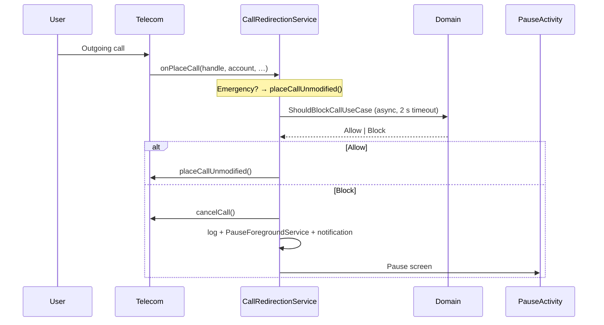

# Instant Pause

**English** · [Español](README.es.md) · [Français](README.fr.md)

> **Former name: CoolDown.** Since version **1.4.0**, the application ID is
> `com.instantpause.app`: `com.cooldown.app` and `com.cooldown` were already taken on
> Google Play. Android therefore treats 1.4.0 as a **different app** — data from the old
> version does not carry over. Only internal class names (`CoolDown*`) keep the old name.

> **Wait until tomorrow before calling.**

Instant Pause is an open-source Android app that helps you **resist impulsive calls**.
During the time windows you set, every outgoing call is intercepted and replaced by a
**sensory pause screen**: breathe, calm down, then decide.

No emergency blocking, no surveillance, no server: everything stays on your phone.

---

## Contents

- [The concept](#the-concept)
- [Features](#features)
- [Protection lock](#protection-lock)
- [How it works](#how-it-works)
- [Architecture](#architecture)
- [Tech stack](#tech-stack)
- [Installation](#installation)
- [Google Play](#google-play)
- [Build](#build)
- [Tests](#tests)
- [Permissions](#permissions)
- [Known limitations](#known-limitations)
- [Roadmap](#roadmap)
- [Privacy](#privacy)

---

## The concept

Many calls are made in a moment of anger, fatigue or impulsiveness — and regretted ten
minutes later. Instant Pause does not remove the ability to call: it **inserts a conscious
delay** between the urge and the action.

Three mechanisms, all controlled by you:

| Mechanism | Effect |
|---|---|
| **Time windows** | Recurring, per day of the week (e.g. 22:00 → 07:00) |
| **Zen mode** | One-off 2-hour block, triggered with a single tap |
| **Whitelist** | Contacts always reachable, even during an active window |

**Emergency numbers** (112, 15, 17, 18, 19…) are **never** blocked.

---

## Features

### 🕐 Protection windows
- Recurring windows on one or more days of the week.
- **Midnight crossing** handled natively (22:00 → 07:00 covers the next morning, taking
  the starting day into account).
- Start bound included, end bound excluded.
- Instant on/off with a switch.

### 🧘 Zen mode
A "Need a pause now?" button enables an immediate **2-hour** protection, without creating
a permanent window.

### 📇 Trusted circle (whitelist)
A **Contacts** tab lets you designate up to **3 people** whose calls always go through,
even in the middle of a protection window.
- The contact is picked from the Android address book (**+** button): the system picker
  only lends the chosen entry, so the app **never** requests the `READ_CONTACTS`
  permission and does not read the rest of the address book.
- The `1 / 3` counter stays visible; at 3, the add button disappears.
- Like switching off a window, **adding or removing** a contact requires the code: it is
  an action that changes the protection.
- Comparison is done in **E.164**, so `06 12 34 56 78`, `+33 6 12 34 56 78` and
  `0033612345678` are recognised as the same number (via `libphonenumber`).
- An allowed call is **capped at 3 minutes**: a floating pill shows "Time left" and the
  timer (`2:59 / 3:00`), the notification repeats it, and a vibration warns at 0:30 then
  0:00.
  The countdown starts at **connection** (ringing does not eat into talk time) and, at
  0:00, the call is **automatically hung up** through the `ANSWER_PHONE_CALLS` permission.
  This permission is **mandatory**: it is requested during installation and the app will
  not open without it, otherwise the 3-minute limit would only be a visual reminder.

### 🌬️ Pause screen
When a call is blocked, a full-screen screen appears (even when locked):
- animated breathing circle and **synchronised gentle vibration**;
- a kind message rather than a plain "Call blocked";
- a **Close** button deliberately inactive for a few seconds.

### 🔔 A single alert
When a call is blocked, **one** "Call blocked" notification appears and vibrates once.
It is never repeated: the call is already declined, insisting every 30 seconds achieves
nothing and pushes people to turn off the app's notifications. It disappears with a tap
(pause screen) or a swipe.

### 📜 History
Every decision is logged locally: number, date, status
(`Blocked`, `Allowed (whitelist)`, `Closed by user`).
Entries older than **90 days** are purged automatically.

### 🔒 Protection lock
An **alphanumeric code** (at least 6 characters, at least one letter and one digit) is
**mandatory from the first launch** of the app: impossible to skip, impossible to delete
afterwards. It prevents turning off the protection on impulse. It is only requested for
actions that **weaken** the protection — never to block a call or add a window.
See [Protection lock](#protection-lock).

### 🛡️ Robustness
- **Watchdog** in a foreground service: the app survives aggressive battery managers
  (Chinese manufacturers in particular).
- **Restart**: protection is re-armed after a reboot or an update.
- **Fail-open**: any error, any timeout or a service death lets the call through. The
  worst case is "the call goes through", never "the call is lost".

---

## Protection lock

The enemy is not an attacker: it is **you**, on a bad day. The lock is therefore designed
to resist impulsiveness, not to protect a secret.

### Mandatory, not optional

On first launch, the app shows a single screen: **choose the code**. As long as it does
not exist, no window, no Telecom role, no setting is accessible. Version 1.1.0 left the
code optional: you could enable protection and then turn it off without ever defining
anything. That is fixed: the code is created cold, before anything else, and it can no
longer be deleted from the app (only a **change**, with the old code, is possible).

The code is created **locked**: even in the seconds after its creation, switching off a
window asks for the code again. No grace period.

### What requires the code

| Action | Code required |
|---|---|
| Switch off an active window | ✅ |
| Delete a window (including an ongoing Zen) | ✅ |
| Change the code | ✅ |
| Remove the uninstall protection | ✅ |
| Block a call, add a window, enable Zen | ❌ |
| View the history | ❌ |

### How it is stored

- **PBKDF2-HMAC-SHA256**, random 16-byte salt, **120,000 iterations**, 256 bits.
- The code is **never** written in plain text: only the salt, the hash and the iteration
  count are kept in DataStore.
- Constant-time comparison (`MessageDigest.isEqual`).
- The "unlocked" state exists **in memory only**: it dies with the process and resets
  after **60 seconds** in the background.

### Progressive delay

Three free attempts, then 30 s, 1 min, 2 min, 4 min… up to **15 minutes** between attempts.
The counter is persisted: killing the app does not reset it; neither does rebooting the
phone.

### Anti-uninstall (Device Admin)

Device admin is **without any policy** (no screen lock, no data wipe). Android then refuses
to uninstall the app while this admin is active.

It is requested **during installation**, right after the code is created: the app does not
move on to call authorisation until it is active. Android requires a system confirmation
(no app can activate itself), but Instant Pause opens that screen automatically rather than
waiting for you to find it in the Security tab.

Once this step is passed, it does not appear again: removing the admin with your code from
the Security tab remains possible, and does not trap the user in a loop.

> **Let's be honest**: no application can prevent an uninstall. The admin adds two steps
> (Settings → Security → Device admin apps → deactivate), and that's it. It is a speed
> bump that breaks the reflex, not a padlock.

### What the lock does not do

- It does **not** block launching the app (a deliberate choice: protection must remain
  consultable).
- It does not resist `adb`, safe mode, or clearing the app's data.
- It does not protect against deactivating the admin from the system Settings.
- **Forgotten code = no recovery possible**: you must clear the app's data (which also
  deletes the windows) or uninstall it after removing the admin.

---

## How it works

Instant Pause uses the **Android Telecom** API `CallRedirectionService`, available since
Android 10 through the system role `ROLE_CALL_REDIRECTION`.



Important design points:

1. **No I/O on the Telecom callback thread** — the decision is computed in a
   `CoroutineScope(SupervisorJob + Dispatchers.IO)`, with a 2 s timeout.
2. **A single response per call** — an `AtomicBoolean` guard per call prevents double
   responses (which would trigger an `IllegalStateException` on the Telecom side).
3. **Explicit fail-open** — every failure is logged, never silent.
4. **Synchronous notification in `decline()`** — Telecom destroys the service right after
   `cancelCall()`; a `launch()` would be cancelled before running.

---

## Architecture

Four layers, with no dependency from the domain to the UI or Android.

```
app/src/main/java/com/instantpause/app/
├── CoolDownApplication.kt          # @HiltAndroidApp
├── data/
│   ├── datastore/ProtectionPrefs.kt    # DataStore: Zen, role, banner, code hash
│   ├── local/                          # Room: entities, DAOs, database, converters
│   └── repository/RepositoryImpls.kt   # Implementations + 90-day purge
├── di/                                 # Hilt modules (DataStore, security, hasher, clock)
├── domain/
│   ├── model/Models.kt                 # Schedule, WhitelistEntry, BlockedLog
│   ├── phone/                          # PhoneNumberAnalyzer (interface) + implementation
│   ├── repository/Repositories.kt      # Contracts
│   ├── security/                       # PassphrasePolicy, PBKDF2, delays, AppLockManager
│   └── usecase/ShouldBlockCallUseCase.kt  # Core logic: Allow / Block
├── system/
│   ├── CoolDownCallRedirectionService.kt  # Telecom interception
│   ├── PauseForegroundService.kt          # Opens the UI from the background
│   ├── CoolDownWatchdogService.kt         # Keeps the process alive
│   ├── WatchdogAlarmReceiver.kt           # Periodic re-arming
│   ├── CoolDownDeviceAdminReceiver.kt     # Anti-uninstall (no policy)
│   ├── ProtectionAlertNotifier.kt         # Channels + notifications
│   └── BootReceiver.kt                    # After reboot / update
└── ui/
    ├── main/      # Home, help banner, role activation
    ├── schedule/  # Windows + history (Compose)
    ├── security/  # Lock: code, delays, device admin
    ├── pause/     # Sensory pause screen
    ├── logs/      # Detailed log
    └── theme/     # Material 3
```

**Business decision** (`ShouldBlockCallUseCase`):

```
Emergency?           → Allow(EMERGENCY_NUMBER)   // never blocked
Zen mode active?     → Block(EMERGENCY_MODE)
Window active?       → Block(SCHEDULE_WINDOW)
Whitelist?           → Allow(WHITELISTED)
Otherwise            → Allow(PROTECTION_INACTIVE)
Error / timeout      → Allow(FAIL_OPEN)
```

---

## Tech stack

| Category | Choice |
|---|---|
| Language | Kotlin 2.2.10 |
| UI | Jetpack Compose + Material 3 (BOM 2026.02.01) |
| Dependency injection | Hilt 2.60.1 (KSP) |
| Local database | Room 2.8.5 |
| Preferences | DataStore Preferences 1.2.1 |
| Phone numbers | libphonenumber 9.0.41 |
| Build | AGP 9.4.1 · JDK 17 |
| SDK | `minSdk 29` (Android 10) · `targetSdk 37` |

No network dependency, no analytics, no account.

---

## Installation

### Download

The latest signed version is available in **[Releases](../../releases/latest)**:

**[⬇ InstantPause-1.4.0.apk](../../releases/download/v1.4.0/InstantPause-1.4.0.apk)** — 6.4 MB · Android 10+

```bash
# Verify the integrity of the downloaded file
sha256sum InstantPause-1.4.0.apk
# → see the hash published in the release (recomputed on every build)
```

> 🔄 **Package renamed in 1.4.0**: versions 1.3.x and earlier used
> `com.cooldown.app`. Android cannot switch from one package to another: to install
> 1.4.0, **uninstall the old version first** (by deactivating its device admin from the
> Security tab). Code, windows and allowed contacts must be created again.

> ⚠️ If a **debug** build is already installed, uninstall it first: the signature
> differs, Android will refuse the update (`INSTALL_FAILED_UPDATE_INCOMPATIBLE`). The
> debug package is `com.instantpause.app.debug`.

> 🛡️ Some preinstalled antivirus apps (AVG/Avast on itel, Infinix…) show "suspicious
> application" for any APK installed outside the Play Store. It is a heuristic on the
> **source**, not an analysis of the code: do not tap "REMOVE". (And if the Instant Pause
> admin is active, uninstallation will fail anyway.)

### Requirements
- Android **10 (API 29)** or higher.
- The manufacturer must expose the **Call Redirection** role
  (available on almost all devices, not guaranteed on heavily modified forks).

### Steps
1. Install the APK (release or local build).
2. Open the app → **choose your protection code**. It is mandatory: the screen cannot be
   bypassed, and the code can no longer be deleted afterwards.
3. Confirm the **anti-uninstall** protection (Device Admin): the system screen opens
   automatically at this step, and the app does not continue until it is active.
4. Grant **Pass and manage phone calls**: this is what allows the call to be cut at
   3 minutes. This step is mandatory — without it, an allowed contact could keep you on
   the phone for an hour.
5. Accept the **Call redirection** role.
6. Allow **full-screen display** (Android 14+): the Android setting opens
   automatically. This step is offered **only once** and is not blocking — without it,
   the pause screen appears as a simple notification to tap.
7. Grant the remaining permissions:
   - **Notifications** (Android 13+) — for the block alert;
   - **Display over other apps** — for the pause screen.
8. Create a time window (or enable Zen mode) and test with a neutral number.

---

## Google Play

The application is published under the identifier **`com.instantpause.app`** — immutable
once the app is created in the Play Console.

| Item | Value |
|---|---|
| Identifier | `com.instantpause.app` (debug: `com.instantpause.app.debug`) |
| Format to upload | **`.aab`** (`gradlew :app:bundleRelease`) |
| Target | `targetSdk 37`, `minSdk 29` |
| Signing | release keystore; Play App Signing then manages the distribution key |
| Data collection | **none** (see [Privacy](#privacy)) |
| Privacy policy | **https://ajanedouby.github.io/instant-pause-privacy/** |

Before the first publication, the Play Console requires:

1. a public **privacy policy URL** — done:
   **https://ajanedouby.github.io/instant-pause-privacy/** (GitHub Pages of the public
   repository [`instant-pause-privacy`](https://github.com/AJANEDOUBY/instant-pause-privacy),
   generated from [`PRIVACY_POLICY.md`](PRIVACY_POLICY.md) and also served as
   [Markdown](https://ajanedouby.github.io/instant-pause-privacy/PRIVACY_POLICY.md));
2. the **Data safety** form — here everything is local: "no data collected";
3. the **justification for sensitive permissions**, to be written when submitting:
   - `ANSWER_PHONE_CALLS`: hang up at 3 minutes a call to an allowed contact;
   - device admin: slow down an impulsive uninstall (no policy is requested from the
     device);
   - `specialUse` foreground service: keeping the protection alive and the call timer;
   - `USE_FULL_SCREEN_INTENT`: show the pause screen over the lock screen;
4. the **foreground services** usage declaration (separate form).

> ⚠️ Play review is the friction point, not the code: device admin and
> `ANSWER_PHONE_CALLS` are the two most scrutinised permissions. The GitHub repository
> remains the distribution channel for signed APKs, independently of the Store.

---

## Build

```bash
# Clone
git clone https://github.com/AJANEDOUBY/CoolDown.git
cd CoolDown

# Debug APK
./gradlew :app:assembleDebug
# → app/build/outputs/apk/debug/app-debug.apk

# Unit tests
./gradlew :app:testDebugUnitTest
```

On Windows: `gradlew.bat`.

The `local.properties` file (SDK path) is not versioned — Android Studio generates it
automatically, or set `sdk.dir=/path/to/Android/Sdk`.

### Publishing a release

The `release.ps1` script chains everything: tests, release build (R8), signing,
verification, git tag and GitHub publication with the APK as an asset.

```powershell
# Full dry run, without tag or publication
.\release.ps1 -DryRun

# With custom release notes
.\release.ps1 -Notes .\notes-1.4.0.md
```

If the signing credentials are set (see below), Gradle produces a signed APK directly:
the script verifies it instead of re-signing it. Otherwise, it produces an unsigned APK,
which the script zipaligns and signs itself with the keystore.

For a Google Play upload, also produce the bundle:

```bash
./gradlew :app:bundleRelease
# → app/build/outputs/bundle/release/app-release.aab
```

### Signing: no secrets in the repository

`app/build.gradle.kts` contains **no** password: it is versioned. Signing credentials are
read from `local.properties` (ignored by git) or, failing that, from environment variables
— handy for CI.

```properties
# local.properties — never commit (already in .gitignore)
signing.storeFile=keystore/cooldown-release.jks
signing.storePassword=…
signing.keyAlias=cooldown
signing.keyPassword=…
```

Equivalent variables: `SIGNING_STORE_FILE`, `SIGNING_STORE_PASSWORD`, `SIGNING_KEY_ALIAS`,
`SIGNING_KEY_PASSWORD`.

Without these values (or without a keystore), the build **does not break**:
`assembleRelease` produces an unsigned APK, and `release.ps1` signs it with
`keystore/cooldown-release.jks`.

> ⚠️ The password appeared in plain text in `app/build.gradle.kts` until commit
> `2fe34c4`. Removing it from the file **does not erase it** from git history. If the
> repository becomes public, rewrite the history (`git filter-repo`) or, simpler and
> safer, change the keystore password and register the new key as an *upload key* in the
> Play Console.

Requirements:

- a **keystore** in `keystore/cooldown-release.jks` (see `.gitignore`: this file must
  **never** be committed);
- a **GitHub token** in `$env:GITHUB_TOKEN`, or credentials registered with the git
  credential manager (`git credential approve`).

The tag created is `v<versionName>`; `versionName`/`versionCode` must be incremented in
`app/build.gradle.kts` before each release.

---

## Tests

81 unit tests cover the business logic, with no Android dependency at runtime:

| Suite | Coverage |
|---|---|
| `ScheduleTest` (11) | windows, included/excluded bounds, days, midnight crossing |
| `ShouldBlockCallUseCaseTest` (8) | emergency, Zen mode, window, whitelist, expiry, default region |
| `BlockStatusConvertersTest` (2) | Room ↔ `BlockStatus` mapping, unknown value |
| `PassphrasePolicyTest` (7) | length, letter + digit, normalisation, accents |
| `PassphraseHasherTest` (7) | determinism, salt, correct/wrong code, corrupted hash |
| `LockoutPolicyTest` (4) | free attempts, doubling, 15 min ceiling, counter |
| `AppLockManagerTest` (20) | lifecycle, code created locked, restart, persisted delay, 60 s relock, change/removal, storage failure |
| `CallTimerTextTest` (4) | `2:59 / 3:00` format, seconds always two digits, Latin digits whatever the locale |
| `OnboardingStageTest` (17) | step order: code → anti-uninstall → hang-up → role → full screen → app |

That is **81 tests** in total.

```bash
./gradlew :app:testDebugUnitTest
# → app/build/reports/tests/testDebugUnitTest/index.html
```

The use case depends on the `PhoneNumberAnalyzer` interface (not on the Android
implementation), which allows it to run with in-memory fakes.

> Scenarios involving Telecom (real interception, foreground services, notifications)
> must be validated on a **physical device**: the emulator does not always expose the
> `ROLE_CALL_REDIRECTION` role.

---

## Permissions

| Permission | Reason |
|---|---|
| `BIND_CALL_REDIRECTION_SERVICE` | Access to the Telecom flow (granted through the system role, not by the user) |
| `POST_NOTIFICATIONS` | Single block alert |
| `VIBRATE` | Haptic feedback on the pause screen |
| `SYSTEM_ALERT_WINDOW` | Show the pause screen above the dialer |
| `USE_FULL_SCREEN_INTENT` | Display on the lock screen — offered once at install on Android 14+ (non-blocking) |
| `RECEIVE_BOOT_COMPLETED` | Re-arming after reboot |
| `SCHEDULE_EXACT_ALARM` | Safety alarm every 15 min (inexact fallback if denied) |
| `REQUEST_IGNORE_BATTERY_OPTIMIZATIONS` | Offer the energy exemption from the banner |
| `FOREGROUND_SERVICE` / `FOREGROUND_SERVICE_SPECIAL_USE` | Watchdog, opening the UI |
| `ANSWER_PHONE_CALLS` | Hang up at 3:00 a call to an allowed contact — mandatory permission at install |
| `BIND_DEVICE_ADMIN` (on the receiver) | Anti-uninstall friction — no policy requested, mandatory step at install |

---

## Known limitations

- **VoIP calls not covered** (WhatsApp, Signal, Messenger, Telegram) — *next project,
  outside the scope of 1.4.x*. These apps do not place calls through Telecom: they open
  their own audio stream, and `CallScreeningService` is never consulted. No Android API
  allows a third-party app to see or reject a VoIP call. Concretely, during a protected
  window:
  - a WhatsApp or Signal call goes through **normally**;
  - Instant Pause does not see it, does not show it in the history and does not display
    the pause screen;
  - only **classic phone calls** are covered.

  The only realistic lead is an **accessibility service** that detects the opening of the
  call window and overlays the pause screen. Three reasons not to have done it:
  1. blocking would be **partial and late**: a screen can be interposed before connection,
     but an already established call cannot be cancelled;
  2. the "Accessibility" permission grants reading of **everything** displayed, messages
     included; for an app that sells peace of mind, this trade-off must be chosen
     explicitly by the user, not inherited from an update;
  3. detection depends on the wording and UI structure of each app: it breaks with every
     WhatsApp or Signal redesign.

  In the meantime, the scope is assumed and displayed as such: **app calls are not
  blocked**. See the [roadmap](#roadmap).
- **Emergency numbers**: deliberately out of scope, and **not testable** in development.
- **Hang-up at 3:00 guaranteed by a mandatory permission**: `TelecomManager.endCall()`,
  the only API that lets a third-party app cut a line, requires `ANSWER_PHONE_CALLS`.
  This permission is part of the installation: without it, the app does not open
  (otherwise the limit would only be a reminder). Once granted, the call is cut cleanly
  at the end of the timer. The pill disappears by itself on hang-up; if the call never
  connected (busy, not answered), it may remain until the 3-minute deadline.
- **Revocable role**: if the system removes `ROLE_CALL_REDIRECTION` (another filtering
  app, an update), protection stops; the app detects it and shows a banner.
- **Bypassable lock**: the code protects the app's settings, not the system. `adb`,
  clearing data, safe mode or deactivating the admin from Settings remain possible. See
  [Protection lock](#protection-lock).
- **Interactive response**: one-tap authorisation (Telecom's `allowInteractiveResponse`)
  is not yet implemented — blocking is binary.
- **Manufacturer fork**: very aggressive overlays (battery management, autostart) can kill
  the watchdog and **delay `BOOT_COMPLETED`** to the point of never delivering it. On
  these devices (itel/Transsion, Xiaomi, Infinix…), allow Instant Pause in
  **Autostart** and **no battery restrictions**. The app shows an amber banner as long as
  the energy exemption is missing. Call interception, however, **keeps working**: Telecom
  restarts the process cold on every call, and the watchdog re-arms on that occasion.

---

## Roadmap

- [ ] Interactive response via `redirectCall()` (allow the call from the pause screen)
- [ ] VoIP call blocking: overlay via accessibility service when
      WhatsApp/Signal/Telegram opens during a protected window (code or breathing to
      enter). **Postponed** — see [Known limitations](#known-limitations) for the
      trade-offs to settle before writing code.
- [ ] Default windows offered on first launch
- [ ] Contact import for the whitelist
- [ ] Statistics (calls avoided per week)
- [ ] Widget / quick settings tile for Zen mode
- [ ] Instrumented tests (PauseActivity, foreground services)

---

## Privacy

The full policy is in [`PRIVACY_POLICY.md`](PRIVACY_POLICY.md) and published online at
**https://ajanedouby.github.io/instant-pause-privacy/**.

- **No network connection.** The app contains neither an HTTP client nor an advertising
  SDK.
- **No account, no identifier.**
- Windows, whitelist and history stay in the application's private storage
  (Room + DataStore).
- `android:allowBackup="false"`: no automatic cloud backup of data.
- Instant Pause's call history is **separate** from the system call log.

---

## Disclaimer

Instant Pause is a self-discipline tool, not a medical device or parental control.
It does not replace professional support if your difficulties are related to your health.

Always test the application with a **neutral number** before relying on it daily.
