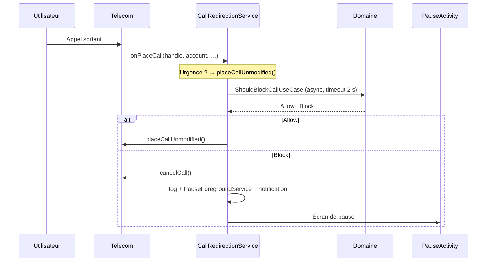

# CoolDown

> **Attendez demain avant d'appeler.**

CoolDown est une application Android open source qui vous aide à **résister aux appels impulsifs**.
Pendant les plages horaires que vous définissez, chaque appel sortant est intercepté et remplacé par
un **écran de pause sensoriel** : respirer, se calmer, puis décider.

Pas de blocage d'urgence, pas de surveillance, pas de serveur : tout reste sur votre téléphone.

---

## Sommaire

- [Le concept](#le-concept)
- [Fonctionnalités](#fonctionnalités)
- [Comment ça marche](#comment-ça-marche)
- [Architecture](#architecture)
- [Stack technique](#stack-technique)
- [Installation](#installation)
- [Compilation](#compilation)
- [Tests](#tests)
- [Permissions](#permissions)
- [Limites connues](#limites-connues)
- [Feuille de route](#feuille-de-route)
- [Confidentialité](#confidentialité)

---

## Le concept

Beaucoup d'appels sont passés dans un moment de colère, de fatigue ou d'impulsivité — et regrettés
dix minutes plus tard. CoolDown ne supprime pas la possibilité d'appeler : il **insère un délai
conscient** entre l'envie et l'action.

Trois mécanismes, tous contrôlés par vous :

| Mécanisme | Effet |
|---|---|
| **Plages horaires** | Récurrentes, par jour de la semaine (ex. 22:00 → 07:00) |
| **Mode Zen** | Blocage ponctuel de 2 heures, déclenché en un tap |
| **Whitelist** | Contacts toujours joignables, même pendant une plage active |

Les **numéros d'urgence** (112, 15, 17, 18, 19…) ne sont **jamais** bloqués.

---

## Fonctionnalités

### 🕐 Plages de protection
- Plages récurrentes sur un ou plusieurs jours de la semaine.
- **Franchissement de minuit** géré nativement (22:00 → 07:00 couvre bien le lendemain matin,
  en tenant compte du jour de départ).
- Borne de début incluse, borne de fin exclue.
- Activation / désactivation instantanée par un interrupteur.

### 🧘 Mode Zen
Un bouton « Besoin d'une pause maintenant ? » active une protection immédiate de **2 heures**,
sans créer de plage permanente.

### ⭐ Whitelist
Ajoutez un contact : il sonnera normalement, même en pleine plage de protection.
La comparaison se fait en **E.164**, donc `06 12 34 56 78`, `+33 6 12 34 56 78` et
`0033612345678` sont reconnus comme le même numéro (via `libphonenumber`).

### 🌬️ Écran de pause
Quand un appel est bloqué, un écran plein écran s'affiche (même verrouillé) :
- cercle de respiration animé et **vibration douce synchronisée** ;
- message bienveillant plutôt qu'un simple « Appel bloqué » ;
- bouton **Fermer** volontairement inactif quelques secondes.

### 🔔 Rappels
Une notification heads-up « Appel bloqué » est postée, puis **re-postée 10 fois toutes les 30 s**
si vous ne réagissez pas. Un tap ouvre l'écran de pause et arrête la séquence.

### 📜 Historique
Chaque décision est journalisée localement : numéro, date, statut
(`Bloqué`, `Autorisé (whitelist)`, `Fermé par l'utilisateur`).
Les entrées de plus de **90 jours** sont purgées automatiquement.

### 🛡️ Robustesse
- **Watchdog** en foreground service : l'app survit aux gestionnaires de batterie agressifs
  (constructeurs chinois notamment).
- **Redémarrage** : la protection est ré-armée après un reboot ou une mise à jour.
- **Fail-open** : toute erreur, tout timeout ou une mort du service laisse passer l'appel.
  Le pire scénario est « l'appel passe », jamais « l'appel est perdu ».

---

## Comment ça marche

CoolDown exploite l'API **Android Telecom** `CallRedirectionService`, disponible depuis Android 10
via le rôle système `ROLE_CALL_REDIRECTION`.



Points de conception importants :

1. **Aucune I/O sur le thread du callback Telecom** — la décision est calculée dans un
   `CoroutineScope(SupervisorJob + Dispatchers.IO)`, avec un timeout de 2 s.
2. **Une seule réponse par appel** — une garde `AtomicBoolean` par appel empêche la double réponse
   (qui provoquerait un `IllegalStateException` côté Telecom).
3. **Fail-open explicite** — chaque échec est journalisé, jamais silencieux.
4. **Notification synchrone dans `decline()`** — Telecom détruit le service juste après
   `cancelCall()` ; un `launch()` serait annulé avant exécution.

---

## Architecture

Organisation en quatre couches, sans dépendance du domaine vers l'UI ou Android.

```
app/src/main/java/com/cooldown/app/
├── CoolDownApplication.kt          # @HiltAndroidApp
├── data/
│   ├── datastore/ProtectionPrefs.kt    # DataStore : mode Zen, rôle, bandeau d'aide
│   ├── local/                          # Room : entités, DAO, base, converters
│   └── repository/RepositoryImpls.kt   # Implémentations + purge 90 jours
├── domain/
│   ├── model/Models.kt                 # Schedule, WhitelistEntry, BlockedLog
│   ├── phone/                          # PhoneNumberAnalyzer (interface) + implémentation
│   ├── repository/Repositories.kt      # Contrats
│   └── usecase/ShouldBlockCallUseCase.kt  # Cœur métier : Allow / Block
├── system/
│   ├── CoolDownCallRedirectionService.kt  # Interception Telecom
│   ├── PauseForegroundService.kt          # Ouverture de l'UI depuis l'arrière-plan
│   ├── ReminderForegroundService.kt       # Rappels 10 × 30 s
│   ├── CoolDownWatchdogService.kt         # Maintien en vie
│   ├── WatchdogAlarmReceiver.kt           # Ré-armement périodique
│   ├── ProtectionAlertNotifier.kt         # Canaux + notifications
│   └── BootReceiver.kt                    # Après reboot / mise à jour
└── ui/
    ├── main/      # Accueil, bandeau d'aide, activation du rôle
    ├── schedule/  # Plages + historique (Compose)
    ├── pause/     # Écran de pause sensoriel
    ├── logs/      # Journal détaillé
    └── theme/     # Material 3
```

**Décision métier** (`ShouldBlockCallUseCase`) :

```
Urgence ?            → Allow(EMERGENCY_NUMBER)   // jamais bloqué
Mode Zen actif ?     → Block(EMERGENCY_MODE)
Plage active ?       → Block(SCHEDULE_WINDOW)
Whitelist ?          → Allow(WHITELISTED)
Sinon                → Allow(PROTECTION_INACTIVE)
Erreur / timeout     → Allow(FAIL_OPEN)
```

---

## Stack technique

| Catégorie | Choix |
|---|---|
| Langage | Kotlin 2.2.10 |
| UI | Jetpack Compose + Material 3 (BOM 2026.02.01) |
| Injection de dépendances | Hilt 2.60.1 (KSP) |
| Base locale | Room 2.8.5 |
| Préférences | DataStore Preferences 1.2.1 |
| Numéros | libphonenumber 9.0.41 |
| Build | AGP 9.4.1 · JDK 17 |
| SDK | `minSdk 29` (Android 10) · `targetSdk 37` |

Aucune dépendance réseau, aucun analytics, aucun compte.

---

## Installation

### Prérequis
- Android **10 (API 29)** ou supérieur.
- Le constructeur doit exposer le rôle **Call Redirection**
  (disponible sur la quasi-totalité des appareils, non garanti sur certains forks très modifiés).

### Étapes
1. Installez l'APK (release ou build locale).
2. Ouvrez l'app → **Activer la protection** → acceptez le rôle **Redirection d'appels**.
3. Accordez les permissions demandées :
   - **Notifications** (Android 13+) — indispensable pour les rappels ;
   - **Affichage par-dessus les autres apps** — pour l'écran de pause ;
   - **Plein écran** (Android 14+) — pour l'affichage écran verrouillé.
4. Créez une plage horaire (ou activez le mode Zen) et testez avec un numéro neutre.

---

## Compilation

```bash
# Cloner
git clone https://github.com/AJANEDOUBY/CoolDown.git
cd CoolDown

# APK de debug
./gradlew :app:assembleDebug
# → app/build/outputs/apk/debug/app-debug.apk

# Tests unitaires
./gradlew :app:testDebugUnitTest
```

Sous Windows : `gradlew.bat`.

Le fichier `local.properties` (chemin du SDK) n'est pas versionné — Android Studio le génère
automatiquement, ou renseignez `sdk.dir=/chemin/vers/Android/Sdk`.

---

## Tests

22 tests unitaires couvrent la logique métier, sans dépendance Android au runtime :

| Suite | Couverture |
|---|---|
| `ScheduleTest` (11) | fenêtres, bornes incluses/exclues, jours, franchissement de minuit |
| `ShouldBlockCallUseCaseTest` (8) | urgence, mode Zen, plage, whitelist, expiration, région par défaut |
| `BlockStatusConvertersTest` (2) | mapping Room ↔ `BlockStatus`, valeur inconnue |

```bash
./gradlew :app:testDebugUnitTest
# → app/build/reports/tests/testDebugUnitTest/index.html
```

Le use case dépend de l'interface `PhoneNumberAnalyzer` (et non de l'implémentation Android),
ce qui permet de l'exécuter avec des fakes en mémoire.

> Les scénarios impliquant Telecom (interception réelle, foreground services, notifications)
> doivent être validés sur un **appareil physique** : l'émulateur n'expose pas toujours le rôle
> `ROLE_CALL_REDIRECTION`.

---

## Permissions

| Permission | Raison |
|---|---|
| `BIND_CALL_REDIRECTION_SERVICE` | Accès au flux Telecom (accordé via le rôle système, pas par l'utilisateur) |
| `POST_NOTIFICATIONS` | Rappels de blocage |
| `VIBRATE` | Retour haptique de l'écran de pause |
| `SYSTEM_ALERT_WINDOW` | Affichage de l'écran de pause au-dessus du dialer |
| `USE_FULL_SCREEN_INTENT` | Affichage sur écran verrouillé |
| `RECEIVE_BOOT_COMPLETED` | Ré-armement après redémarrage |
| `FOREGROUND_SERVICE` / `FOREGROUND_SERVICE_SPECIAL_USE` | Watchdog, rappels, ouverture d'UI |

---

## Limites connues

- **Appels VoIP non couverts** : WhatsApp, Signal, Messenger, Telegram… ne passent pas par
  Telecom et ne peuvent donc pas être interceptés par cette API.
- **Numéros d'urgence** : volontairement hors périmètre, et **non testables** en développement.
- **Rôle révocable** : si le système retire `ROLE_CALL_REDIRECTION` (autre app de filtrage,
  mise à jour), la protection s'arrête ; l'app le détecte et affiche un bandeau.
- **Réponse interactive** : l'autorisation en un tap (`allowInteractiveResponse` de Telecom)
  n'est pas encore implémentée — le blocage est binaire.
- **Fork constructeur** : les surcouches très agressives (gestion batterie) peuvent tuer le
  watchdog ; pensez à exclure l'app de l'optimisation batterie.

---

## Feuille de route

- [ ] Réponse interactive via `redirectCall()` (autoriser l'appel depuis l'écran de pause)
- [ ] Plages par défaut proposées au premier lancement
- [ ] Import de contacts pour la whitelist
- [ ] Statistiques (appels évités par semaine)
- [ ] Widget / tuile de réglages rapides pour le mode Zen
- [ ] Tests instrumentés (PauseActivity, foreground services)

---

## Confidentialité

- **Aucune connexion réseau.** L'app ne contient ni client HTTP ni SDK publicitaire.
- **Aucun compte, aucun identifiant.**
- Plages, whitelist et historique restent dans le stockage privé de l'application
  (Room + DataStore).
- `android:allowBackup="false"` : pas de sauvegarde cloud automatique des données.
- L'historique des appels de CoolDown est **distinct** du journal d'appels système.

---

## Avertissement

CoolDown est un outil d'auto-discipline, pas un dispositif médical ni un contrôle parental.
Il ne remplace pas un accompagnement professionnel si vos difficultés sont liées à votre santé.

Testez toujours l'application avec un **numéro neutre** avant de compter dessus au quotidien.
